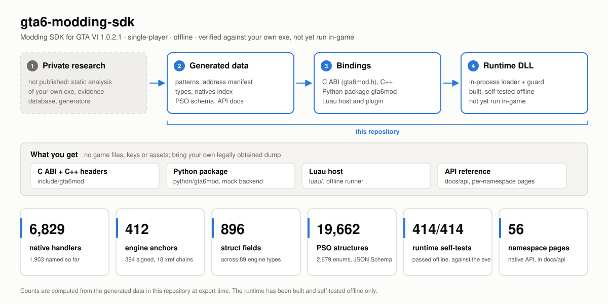

# gta6-modding-sdk

A single-player modding SDK for **GTA VI build 1.0.2.1** (Xbox Series dump): a stable C ABI, generated C, C++, Python and Luau bindings, an in-process runtime DLL, an API reference and a PSO schema. Every address and layout was verified offline against your own copy of the game executable.


<picture>
  <source media="(prefers-color-scheme: dark)" srcset="docs/assets/overview-dark.svg">
  
</picture>

> [!IMPORTANT]
> **Status: built and self-tested offline, never run in-game.** Mods can be written and unit-tested today against the mock runtime. The runtime DLL builds and passes its self-test against the executable *file*, but it has not been loaded into a running game yet.

## What works today

| Piece | Status |
|---|---|
| C ABI (`include/gta6mod/gta6mod.h`) | Stable host function table and plugin entry points, size-versioned; implemented by the mock runtime |
| Natives | **6,829 handlers** with typed wrappers in C, C++, Python and Luau; 1,886 carry a name, the rest are exposed by hash (`N.RAW.N_<hash>`); 13 seed-only entries are marked `unverified` and refused by real backends unless you opt in |
| Engine anchors (`include/gta6mod/patterns.hpp`) | **399 anchors**: 384 byte signatures unique in the 1.0.2.1 exe, 15 resolved through xref chains |
| Types (`classes.hpp`, `offsets.hpp`) | 85 engine types, 867 fields, with `static_assert` offsets |
| PSO schema (`data/generated/pso/`) | 19,178 structures, 77,044 members and 2,572 enums as JSON Schema (draft 2020-12), plus an XSD for the 67 structures with a known name |
| Python package (`python/gta6mod`) | Mock backend and a ctypes backend over the C ABI; PE reader, signature scanner, pattern resolver and RPF9/RDS5 header readers that work on your own dump |
| Luau host (`luau/`) | Plugin DLL, embedding API and an offline runner; the example mod runs against the mock world |
| Runtime DLL (`runtime/loader`) | Builds with clang-cl (`/W4 /WX`); self-test **355/355** offline against the exe file; **not yet run in-game** |
| API reference (`docs/api`) | One page per native namespace, plus types, anchors, the native ABI and the PSO type table |

## Architecture

The SDK has three layers:

1. **Platform and runtime.** `runtime/loader` builds `gta6mod_runtime.dll`. It checks the executable's identity, resolves anchors by signature, checks each native handler statically, installs the script-thread tick hook and keeps a single-player guard. `runtime/src/mock_backend.c` implements the same C ABI offline. The design is in [`docs/runtime_design.md`](docs/runtime_design.md).
2. **Generated bindings.** The native wrappers, `patterns.hpp`, the type headers, the address manifest, the PSO schema and the API pages are generated files. Do not edit them by hand.
3. **Stable public API.** Mods use `gta6mod.h` (C), `natives.hpp` (C++), the `gta6mod` Python package or the Luau library. This layer is meant to stay the same across game builds; only the generated layer changes.

The generated files come from a private evidence database, where every address, type and name has its provenance and a confidence level. The research tooling and that database are not part of this repository.

## Quick start

All commands run from the repository root in PowerShell. `<DUMP>` is the folder of your own dump, the one that holds `game_scarlett_master.exe`.

### Python SDK

```powershell
$env:PYTHONPATH = "$PWD\python"          # or: pip install -e .
python -m gta6mod info "<DUMP>"                                              # exe build check and archive headers
python -m gta6mod patterns check --exe "<DUMP>\game_scarlett_master.exe"     # every pattern unique at its RVA
python -m gta6mod anchors verify --exe "<DUMP>\game_scarlett_master.exe"     # the seed anchors
python -m gta6mod run examples\python\spawn_car.py --ms 5000 --press 51@1008 # example mod on the mock world
```

`patterns check` is the gate to run after every game update: each pattern must match exactly once, at its recorded RVA.

### Tests

```powershell
python -m unittest discover -s tests\python -v
$env:G6_DUMP = "<DUMP>"; python -m unittest discover -s tests\python -v   # adds the dump-gated checks
```

### Runtime DLL

Needs LLVM's `clang-cl` (`C:\Program Files\LLVM\bin` or `PATH`) and the MSVC Build Tools with a Windows SDK.

```powershell
runtime\loader\build.cmd test                              # build, then run the offline self-test
runtime\loader\build.ps1 -Test -Dump "<DUMP>"              # also runs the checks against your exe file
```

### Luau host

`luau\build.cmd` clones Luau at the pinned tag (0.650) into `build\_deps` on first use and builds the plugin, the offline runner and the tests into `build\luau`.

```powershell
luau\build.ps1 -Test
build\luau\g6_luau_runner.exe luau\lib luau\examples\spawn_car\init.luau 5000 --press 51@1008
```

### CMake (all targets)

```powershell
cmake -S . -B build-cmake -G Ninja -DCMAKE_C_COMPILER=clang-cl -DCMAKE_CXX_COMPILER=clang-cl `
      -DG6_WITH_RUNTIME_LOADER=ON -DG6_WITH_LUAU=ON
cmake --build build-cmake
ctest --test-dir build-cmake --output-on-failure
```

The CMake build was verified in the private development tree (CMake 4.4.5, Ninja 1.13.2, clang-cl 23.1.6), not in this exported copy. The verified path here is `build.cmd`.

## Repository layout

| Path | Contents |
|---|---|
| `include/gta6mod/` | `gta6mod.h` (C ABI); generated `natives.h`, `natives.hpp`, `patterns.hpp`, `classes.hpp`, `offsets.hpp` |
| `python/gta6mod/` | Python package: runtime backends, generated natives, PE, patterns, anchors, format headers, CLI |
| `luau/` | Luau host (plugin, embedding API, runner), generated `natives.luau`, example and tests |
| `runtime/loader/` | Runtime DLL sources, self-test and build scripts ([README](runtime/loader/README.md)) |
| `runtime/src/` | Mock implementation of the C ABI |
| `data/generated/` | Natives index, pattern index, address manifest, types index, PSO schema |
| `data/seed/` | Seed natives and anchors |
| `docs/` | [Runtime design](docs/runtime_design.md), [API reference](docs/api/index.md), [native signatures](docs/native-signatures.md) |
| `examples/`, `tests/` | Example Python mod; Python unit tests and C/C++ header checks |

## Guardrails and scope

- **Single-player and offline only.** NETWORK natives are always refused. Every other native, and the `mods/` overlay, stays refused while the single-player guard is closed. Nothing here touches online services, anti-cheat or networking code.
- **No game content.** This repository contains no game files, keys, decrypted data or assets. The tools read only the files you point them at.
- **Bring your own dump.** You need your own legally obtained copy of the game. Identity checks refuse any other executable build.

## Disclaimer

This is an independent project. It is not affiliated with, endorsed by or sponsored by Rockstar Games or Take-Two Interactive. Grand Theft Auto and related names are trademarks of their respective owners.

## License

License: not yet chosen; all rights reserved until a license is added.
